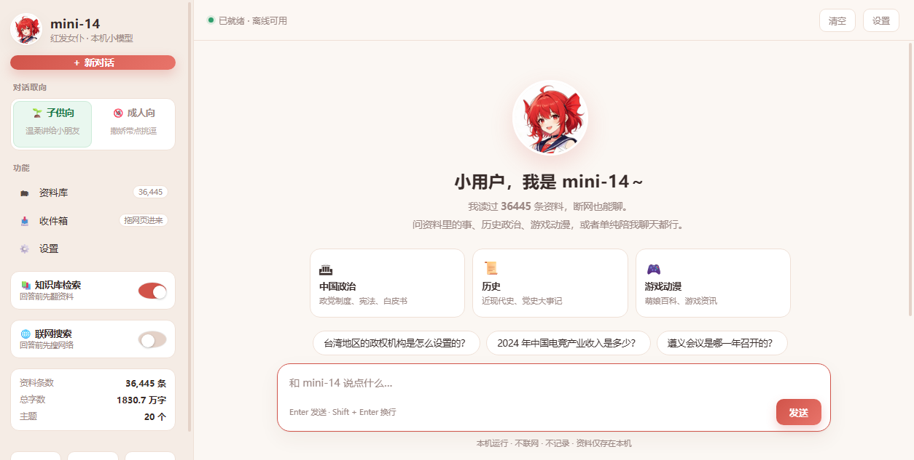
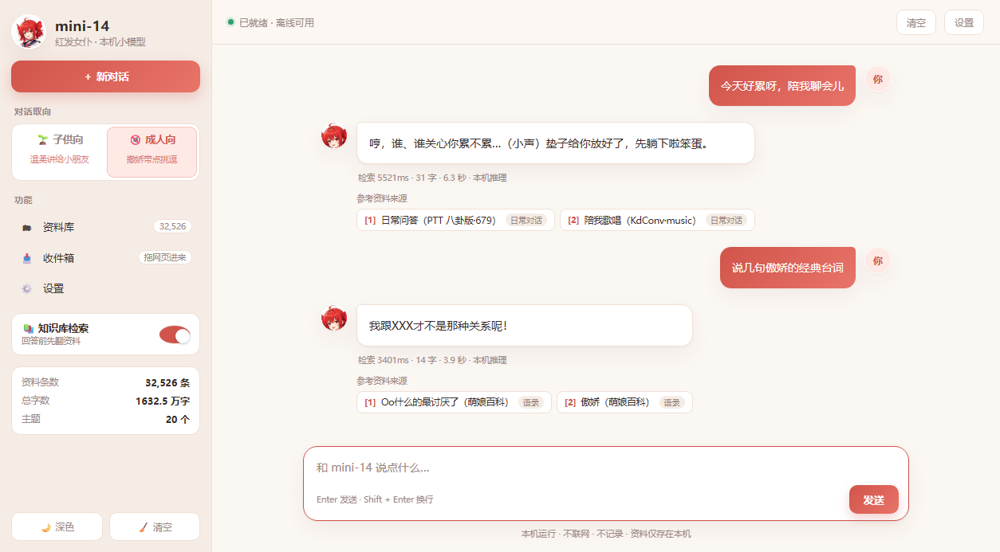
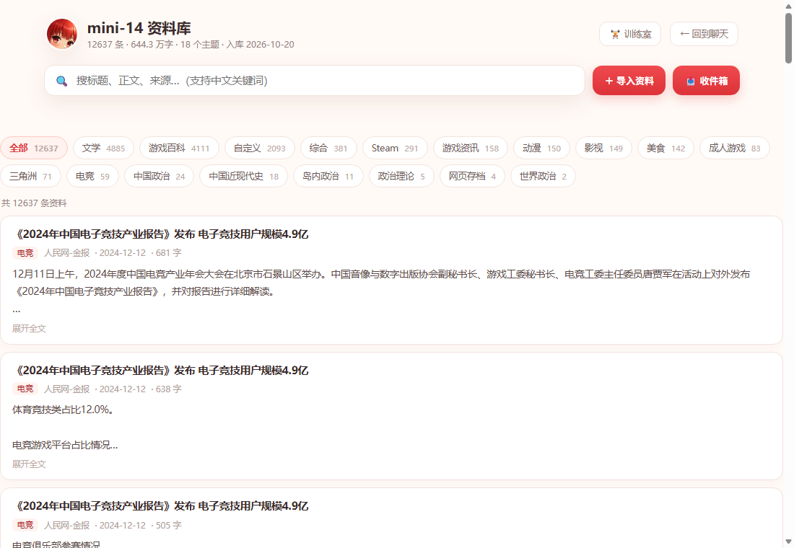

# mini-14 v1.1

**一个完全离线的本地 AI 助手：小模型 + 个人知识库 + 可切换人格，断网可用。**

> 1.5B 参数的小女仆「小十四」，跑在你自己的电脑上。没有云端、没有账号、没有上传。
> v1.1 新增：**联网搜索开关**、**简体 / 繁体切换**、**数据库按需下载**。



---

## 特性

| | |
|---|---|
| 🧠 **本地推理** | llama.cpp（Vulkan 加速，自动回退 CPU）+ Qwen2.5-1.5B-Instruct Q4_K_M |
| 📚 **个人知识库** | 3 万+ 条自定义资料，bge-m3 向量检索 + BM25 字符二元组混合排序（z-score 融合） |
| ⚡ **分片索引** | 按主题把索引拆成 N 个分片，打开只加载 manifest（2.5 KB），提问时按语义中心向量路由，只加载命中的分片 |
| 🎭 **双人格** | 子供向（温柔简单）/ 成人向（傲娇嘴硬），语气与内容边界都不同，统一称呼用户为「小用户」 |
| 🌐 **联网搜索（v1.1）** | 侧边栏开关，默认关闭；开启后每次提问先联网搜 6 条结果，作为「网络」资料参考 |
| 🈶 **简繁切换（v1.1）** | 一键切换界面 + 回答；OpenCC 词表转换（31,008 词 / 4,012 字），台湾用语 |
| 💾 **数据库按需下载（v1.1）** | 首次启动可**选择**是否下载知识库；也可导入本地 zip，或跳过只用空库 |
| 🎨 **可换外观** | 深浅色、正文颜色、自定义头像与图标 |
| 📥 **多种入库方式** | 网页拖拽导入、收件箱（支持保存的 HTML/YouTube 页面）、JSONL 批量导入 |
| 🔌 **全离线** | 默认所有请求只发往 `127.0.0.1`，拔网线可用；只有主动开启联网搜索才会出网 |





---

## 更新日志

### v1.1

- **联网搜索**：侧边栏新增开关，`/websearch` 走 360 搜索（Bing 兜底），结果标「网络」并提示可能过时
- **简体 / 繁体**：界面 + 回答一起切换，OpenCC 词表保证「臺灣」「頭髮」这类词正确
- **数据库按需下载**：`数据库下载.cmd` 三选一（下载 / 本地 zip / 跳过），首次启动自动询问；
  配 `tools\pack-kb.ps1` 可把当前库打包上传到 Release 供别人下载
- **导入自愈**：导入服务改为 wscript 常驻，启动时校验端口，异常写日志不退出；新增 `修复导入.cmd`
- **语气与称呼**：成人向改为傲娇（哼 / 笨蛋小用户 / 才不是…呢），两个模式统一称呼「小用户」
- **索引分片**：打开页面从 ~4 秒降到 ~0.2 秒，提问按语义路由只加载 2~3 个主题分片
- 新增回答缓存（同问题 0.2 秒返回）

### v0.1

- 初始版本：本地推理、RAG、资料库、导入、训练室

---

## 架构

```
┌─────────────────────────────────────────────────────────┐
│ 浏览器 (Edge/Chrome)                                     │
│  index.html  ── 聊天 / 人格 / 主题 / 配色                │
│  kb.html     ── 资料库浏览、搜索、导入                    │
└───────┬───────────────────────────────┬─────────────────┘
        │ 流式对话                        │ 导入
┌───────▼──────────┐           ┌────────▼───────────────┐
│ 18014 聊天服务    │           │ 18018 导入服务 (Node)   │
│ llama-server     │           │ /add /scan-inbox       │
│ Qwen2.5-1.5B     │           │ 切块→向量→写库→重建分片 │
└───────┬──────────┘           └────────┬───────────────┘
        │ 提问向量                        │
┌───────▼──────────┐           ┌────────▼───────────────┐
│ 18016 向量服务    │◄──────────│ web/kb/                │
│ llama-server     │           │  chunks.json           │
│ bge-m3 (1024d)   │           │  manifest.json         │
└──────────────────┘           │  centroids.f32         │
                               │  shards/<topic>.{json,f32}
                               └────────────────────────┘
```

**检索流程**：问题 → 向量化 → 与主题中心向量比较，取 Top-3 主题 → 加载对应分片 →
分片内做 cosine + BM25 混合打分 → z-score 融合（0.8 / 0.2）→ 每篇文档取一段 → 拼进提示词。

---

## 快速开始

### 1. 依赖

- Windows 10/11（脚本是 PowerShell；核心服务跨平台）
- [llama.cpp](https://github.com/ggml-org/llama.cpp) 的 `llama-server`（Vulkan 或 CPU 构建）
- Node.js 18+（导入服务、构建脚本）
- 两个 GGUF 模型：
  - `qwen2.5-1.5b-instruct-q4_k_m.gguf`
  - `bge-m3-Q4_K_M.gguf`

### 2. 目录约定

```
D:\mini-14\
├─ models\            两个 .gguf
├─ runtime\           llama-server.exe（vulkan / cpu）、node.exe、python
├─ web\               前端页面 + kb\ 数据
├─ tools\             建库 / 导入 / 自检脚本
└─ logs\
```

> ⚠️ 目前脚本默认根目录是 `D:\mini-14`，见 [Roadmap](#roadmap)。

### 3. 建库

```powershell
# 启动向量服务（18016）
.\launcher.ps1

# 把 JSONL 资料（name/text/url/source/topic）切块 + 向量化
node tools\build_kb.mjs 你的资料.jsonl

# 生成按主题的分片索引
node tools\shard_kb.mjs

# 启动聊天界面
.\start.vbs
```

### 4. 加资料

- 浏览器打开 `http://127.0.0.1:18014/kb.html`，点「＋ 导入资料」
- 或把网页/文本丢进 `inbox\`，点「📥 收件箱」
- 或 `node tools\import_jsonl.mjs <file.jsonl> [topic]`

导入后会自动重建分片索引（约 3 秒）。

---

## 数据库：可选下载

首次启动时如果 `web\kb` 为空，会弹出三选一菜单（也可随时运行 `数据库下载.cmd`）：

1. **下载 demo 数据库**（推荐，45 MB）——Release 附件 `mini14-kb.zip`
2. **导入本地 zip**（自己打包的库）
3. **跳过**——只用空库聊天

**demo 数据库内容**（10,974 条 / 518 万字，只含可再分发来源）：

| 来源 | 许可 |
|---|---|
| Project Gutenberg 中文公版书 | Public Domain |
| 中国政府网（政策文件 / 白皮书） | 政府文件，不受著作权保护 |
| 中共中央党史和文献研究院（大事记） | 官方文件 |
| KdConv 中文多轮对话 | Apache-2.0 |

**完整数据库**（1,830 万字，含萌娘百科等版权内容）**不公开分发**。
想给自己或团队用：运行 `tools\pack-kb.ps1` 打包 → 传到私有 Release / 自己的服务器 →
把地址写进 `tools\db-url.txt` 即可复用一键下载。

---

## 仓库里**没有**什么

为了合规与体积，本仓库不包含：

- **模型权重**（Qwen2.5 与 bge-m3，按各自许可证自行下载）
- **完整语料**（萌娘百科 CC BY-NC-SA、新闻站点版权归原作者；demo 库只含公版/政府/Apache 内容）

前端代码、检索与分片算法、导入服务、脚本全部开源。

---

## Roadmap

- [ ] 去除硬编码路径（`MINI14_ROOT` 环境变量）
- [ ] Linux / macOS 启动脚本
- [ ] 插件化的主题分类器（替换中心向量路由）
- [ ] 对话风格微调实验（LoRA）

---

## 发布 / 收录\n\n看到这份 README 的你，可以按 [PUBLISH.md](PUBLISH.md) 把项目发布到 GitHub 并开启 Pages，\n搜索引擎收录通常需要几天到两周。\n\n## 许可证

MIT —— 见 [LICENSE](LICENSE)。
